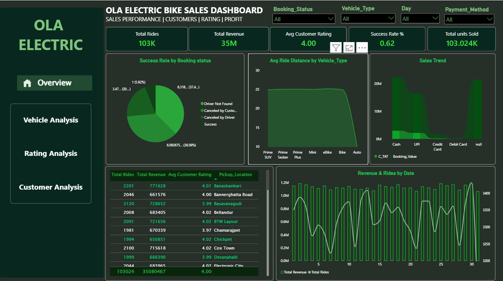
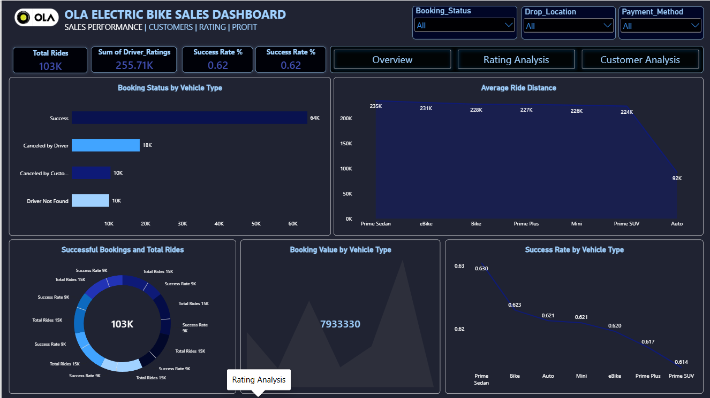
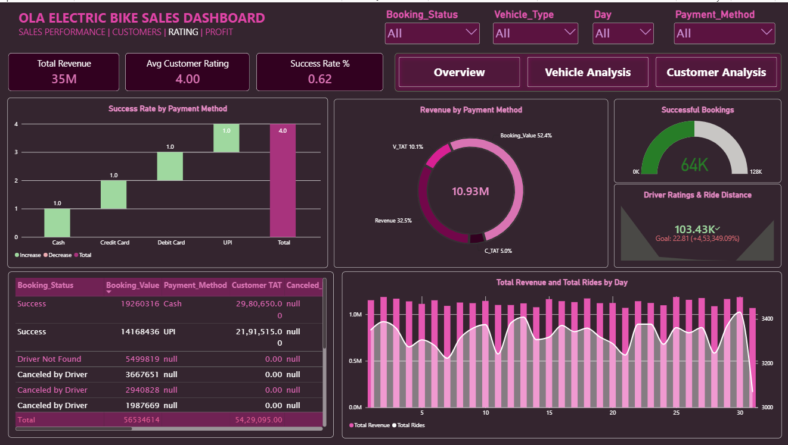
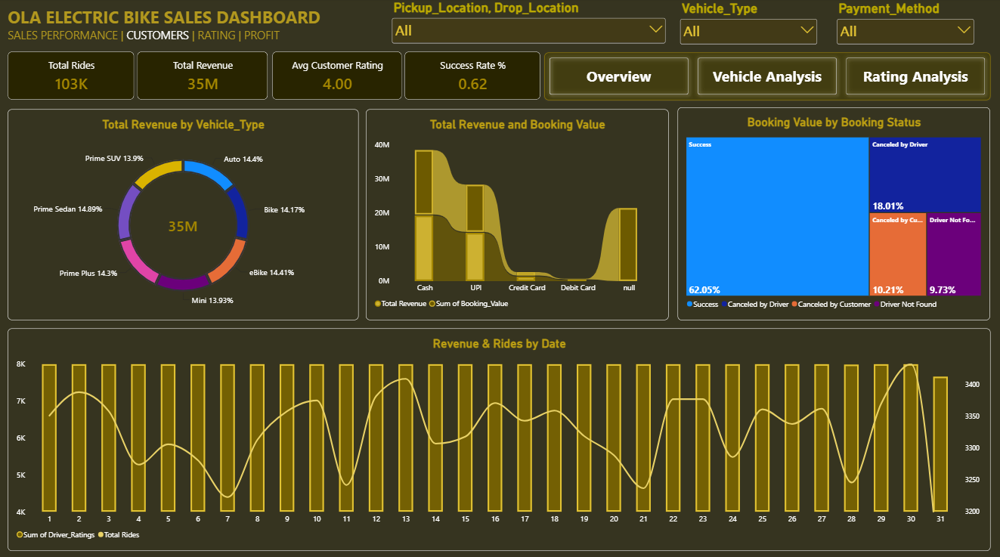

# OLA Data Analysis and Visualization Project

This repository showcases an end-to-end data analysis and visualization project based on OLA ride-booking data. The project focuses on analyzing booking trends, vehicle performance, customer behavior, ratings, and ride-booking patterns using Microsoft Excel and Power BI.

The project uses a dataset containing over 100,000 ride-booking records to explore business insights and present them through interactive dashboards. It demonstrates practical data analytics skills, data exploration, and dashboard design.

---

## Project Objective

The main objective of this project is to analyze OLA ride-booking data and transform raw booking records into meaningful business insights.

The analysis focuses on:

- Understanding ride-booking trends and booking status distribution.
- Analyzing vehicle types and ride-related metrics.
- Evaluating customer ratings and customer behavior.
- Identifying booking patterns and customer-related insights.
- Presenting key performance indicators through interactive Power BI dashboards.

---

## Repository Structure

This repository contains the following files:

### 1. **[Booking_details dataset.xlsx](Booking_details%20dataset.xlsx)**

The Excel dataset contains more than 100,000 ride-booking records with details about bookings, customers, vehicles, payments, and ratings.

Key columns include:

- `Date` and `Time`
- `Booking_ID`
- `Booking_Status`
- `Customer_ID`
- `Vehicle_Type`
- `Pickup_Location` and `Drop_Location`
- `V_TAT` and `C_TAT`
- `Canceled_Rides_by_Customer`
- `Canceled_Rides_by_Driver`
- `Incomplete_Rides` and `Incomplete_Rides_Reason`
- `Booking_Value`
- `Payment_Method`
- `Ride_Distance`
- `Driver_Ratings`
- `Customer_Rating`

**Purpose:** Used as the primary data source for exploring ride-booking information and building Power BI visualizations.

### 2. **[OLA analysis.pbix](OLA%20analysis.pbix)**

This is the Power BI report file containing interactive dashboards for analyzing OLA ride-booking data.

The report includes four main dashboard pages:

1. **Overview:** Provides a high-level summary of ride-booking performance and overall booking trends.
2. **Vehicle Analysis:** Explores vehicle categories and ride-related performance metrics.
3. **Rating Analysis:** Examines customer and driver ratings to understand service quality.
4. **Customer Analysis:** Focuses on customer-related booking patterns and insights.

**Purpose:** Presents data through interactive visuals, charts, and report filters to support data-driven decision-making.

### 3. **[Overview.png](Overview.png)**

Screenshot of the Overview dashboard.

This image provides a visual preview of the overall ride-booking analysis and key performance indicators.

### 4. **[Vehicle.png](Vehicle.png)**

Screenshot of the Vehicle Analysis dashboard.

This image showcases the analysis of different vehicle categories and their related performance metrics.

### 5. **[Rating.png](Rating.png)**

Screenshot of the Rating Analysis dashboard.

This image provides a preview of the rating-related visualizations used to analyze customer and driver feedback.

### 6. **[Customer.png](Customer.png)**

Screenshot of the Customer Analysis dashboard.

This image showcases customer-related visualizations and booking insights.

### 7. **[README.md](README.md)**

Documentation for the project, including its objective, repository structure, dashboard descriptions, tools, and instructions for exploring the analysis.

---

## Dashboard Preview

The Power BI report contains four interactive dashboard pages designed to present the analysis in a clear and organized format.

### 1. Overview Dashboard

Provides an overall view of OLA ride-booking performance and booking trends.

### 2. Vehicle Analysis Dashboard

Presents vehicle-related metrics and comparisons across available vehicle categories.

### 3. Rating Analysis Dashboard

Highlights rating-related insights to help understand customer feedback and driver performance.

### 4. Customer Analysis Dashboard

Provides insights into customer booking behavior and related performance indicators.

---

## Key Areas of Analysis

### 1. Booking Analysis

- Analyze booking status distribution.
- Understand successful bookings and different booking outcomes.
- Explore ride-booking patterns using date and time information.
- Examine booking-related performance indicators.

### 2. Vehicle Analysis

- Compare different vehicle categories.
- Explore ride distances across vehicle types.
- Analyze vehicle-related booking performance.
- Identify differences between vehicle categories using dashboard visualizations.

### 3. Customer Analysis

- Explore customer-related booking patterns.
- Analyze customer booking information.
- Understand customer behavior using available booking data.
- Present customer-related insights through interactive visuals.

### 4. Rating Analysis

- Examine customer ratings.
- Analyze driver ratings.
- Compare rating patterns across vehicle categories.
- Use ratings to explore service quality and customer satisfaction.

### 5. Booking Status Analysis

The dataset includes the following booking statuses:

- Success
- Canceled by Driver
- Canceled by Customer
- Driver Not Found

Analyzing these statuses helps understand successful bookings, cancellation patterns, and unsuccessful booking outcomes.

---

## Tools and Technologies Used

- **Microsoft Excel:** Used to store and explore the ride-booking dataset.
- **Microsoft Power BI:** Used to create interactive dashboards, charts, and visual reports.
- **Data Analysis:** Used to explore booking information, customer behavior, vehicle categories, and ratings.
- **Data Visualization:** Used to communicate findings through interactive visual representations.

---

## Dataset Overview

The dataset contains over 100,000 ride-booking records and includes information related to:

- Booking details and timestamps.
- Customer and vehicle information.
- Pickup and drop locations.
- Booking status and cancellation details.
- Booking value and payment methods.
- Ride distance and ratings.
- Incomplete rides and related reasons.

This dataset provides a foundation for exploring operational performance and customer-related patterns in ride-booking services.

---

## How to Use This Repository

1. **Clone or Download the Repository**

   Download the repository as a ZIP file or clone it using Git.

2. **Explore the Dataset**

   Open `Booking_details dataset.xlsx` in Microsoft Excel to examine the ride-booking data.

3. **Open the Power BI Report**

   Open `OLA analysis.pbix` using Power BI Desktop.

4. **Explore the Dashboards**

   Navigate through the Overview, Vehicle Analysis, Rating Analysis, and Customer Analysis pages to explore the available visualizations and insights.

5. **Review Dashboard Screenshots**

   Open `Overview.png`, `Vehicle.png`, `Rating.png`, and `Customer.png` to view the dashboard previews directly.

---

## Project Outcomes

This project demonstrates the practical application of data analysis and visualization techniques to ride-booking data.

The key outcomes include:

- Organizing and exploring a large ride-booking dataset.
- Analyzing booking statuses and ride-related metrics.
- Exploring vehicle categories, customer behavior, and ratings.
- Developing interactive dashboards using Power BI.
- Presenting data in a format that supports business understanding and decision-making.

---

## Future Enhancements

- Incorporate SQL queries for more advanced data analysis.
- Add additional KPIs and detailed booking performance metrics.
- Develop deeper cancellation and revenue analysis.
- Introduce time-based comparisons and trend analysis.
- Enhance dashboard interactivity with additional slicers, drill-through pages, and tooltips.
- Integrate Python for advanced analytics and predictive modeling.

---

## Conclusion

The OLA Data Analysis and Visualization Project demonstrates how ride-booking data can be explored and presented through interactive business intelligence dashboards.

By combining Excel-based data exploration with Power BI visualization, this project showcases practical data analytics skills and provides a foundation for further analysis of booking performance, vehicle categories, customer behavior, and service ratings.

This project is suitable for showcasing data analysis and dashboard development skills in a data analytics portfolio.

---

**Tools:** Microsoft Excel | Microsoft Power BI | Data Analysis | Data Visualization
